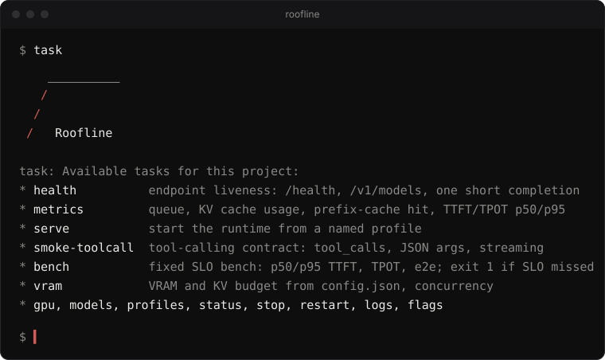

<picture>
  <source media="(prefers-color-scheme: dark)" srcset="brand/png/readme-header-dark-1200x400-2x.png">
  
</picture>

 Roofline, линейка Lenialno. [English](README.md)

Agent Skills для роли Inference Engineer: vLLM или SGLang на своих GPU за OpenAI-совместимым endpoint, Claude Code и Qwen Code через прокси, стабильная работа на air-gap хостах. 13 skills, один subagent Claude Code и toolbox на [Taskfile](https://taskfile.dev/); карта компетенций повторяет [roadmap.sh/inference-engineering](https://roadmap.sh/inference-engineering).

## Быстрый старт

Как Agent Skills, для любого агента с их поддержкой (Claude Code, Codex, Cursor, OpenCode и другие):

```bash
npx skills add lenialno/roofline --list                                           # что внутри
npx skills add lenialno/roofline --skill roofline-runtime-ru --skill roofline-toolbox   # выбранные skills
npx skills add lenialno/roofline --all                                            # всё, для всех агентов
npx skills add lenialno/roofline -g -a claude-code --skill roofline-toolbox       # user scope, только Claude Code
```

Как Claude Code plugin, доступный во всех проектах на машине, из каталога Lenialno [lenialno/skills](https://github.com/lenialno/skills):

```bash
claude plugin marketplace add lenialno/skills
claude plugin install roofline@lenialno
```

> [!TIP]
> Обновление: `claude plugin marketplace update lenialno`, затем `claude plugin update roofline@lenialno` и `/reload-plugins`. Локальный клон на одну сессию: `claude --plugin-dir /path/to/roofline`.

Потом спросите агента, с чего начать с локальным LLM-сервером. Skill `roofline-ru` направит вопрос к нужному skill, задаче или subagent.

Для toolbox нужны python3 и curl, [go-task](https://taskfile.dev) для `task` и nvidia-smi для задачи `gpu`. Скрипты работают и без task.

## Skills

| Skill | Что покрывает | Когда звать |
|---|---|---|
| `roofline` | маршрутизатор роли: первые шаги, что в роли и что вне, какой skill, задачу или агента брать | "с чего начать", "это моя задача?", "какой skill за это отвечает" |
| `roofline-runtime` | поднять vLLM или SGLang и держать в порядке: выбор движка, порядок флагов, профили запуска, air-gap, docker | "запусти или останови сервер", "vLLM или SGLang", "выставь TP или max-model-len", "не стартует" |
| `roofline-toolcall` | tool calling и chat template: парсеры по семейству модели, стриминг `tool_calls`, подключение Claude Code и Qwen Code | "tool calls приходят текстом", "аргументы не валидный JSON", "400 на role tool" |
| `roofline-perf` | бюджет VRAM и KV-кеша, батчинг, prefix cache, квантование и его цена, спекулятивное декодирование, методика бенча | "почему медленно", "больше throughput", "какое квантование", "как читать бенч" |
| `roofline-incident` | runbook: триаж `health`, `metrics`, `gpu`, `logs`; виды OOM, очередь, нарушение p95, регрессы после обновлений, постмортем | "сервер лежит", "память GPU забита", "p95 подскочил", "Claude Code выдаёт ошибки" |
| `roofline-capacity` | расчёт GPU, VRAM и TP, concurrency под SLO, реплики, выбор модели по evals, canary и откат, стоимость | "сколько GPU", "какая модель влезет", "сколько одновременных пользователей", "как выкатить безопасно" |
| `roofline-toolbox` | Taskfile и скрипты без зависимостей, которые зовут остальные skills | "проверь, запусти, останови, прогони бенч или пробу на сервере", либо другой skill просит запустить задачу |

Агенты выбирают skill по описанию, так что фраз из последней колонки достаточно. Первые шесть есть и на русском под тем же именем с суффиксом `-ru`: `roofline-ru`, `roofline-runtime-ru`, `roofline-toolcall-ru`, `roofline-perf-ru`, `roofline-incident-ru`, `roofline-capacity-ru`. Toolbox от языка не зависит и общий для обоих наборов.

> [!NOTE]
> MCP-серверов и hooks нет, и это намеренно. Живое состояние даёт [Task](https://taskfile.dev/): агент читает память GPU, health, метрики и логи с реального сервера, а не угадывает.

## Subagent

`incident-investigator` ([agents/incident-investigator.md](agents/incident-investigator.md)) это subagent Claude Code, которому `roofline-incident-ru` передаёт расследование, когда нужны длинные логи или метрики за часы. Он только читает и измеряет (`health`, `metrics`, `gpu`, `models`, `logs`, `smoke-toolcall`), никогда не запускает `serve`, `stop` или `restart` и возвращает вердикт не длиннее 25 строк: причина, доказательства, отброшенные гипотезы, следующий шаг.

## Toolbox

Taskfile плюс скрипты на bash и python3 без зависимостей в [skills/roofline-toolbox/](skills/roofline-toolbox/SKILL.md); корневой `Taskfile.yml` реэкспортирует его без namespace. Каждая задача идемпотентна и завершается ненулевым кодом при ошибке. Из любого проекта:

```bash
task -t /path/to/roofline/Taskfile.yml health
```

Или подключите его в проектный Taskfile и зовите `task infer:health`:

```yaml
version: '3'
includes:
  infer:
    taskfile: /path/to/roofline/skills/roofline-toolbox/Taskfile.yml
```

Команды выполняются в каталоге, откуда вызван `task`: там лежат `inference.env` (строки `KEY=value`) и `.inference-state/`. `task` без аргументов печатает список задач под знаком Roofline.



> [!NOTE]
> `task serve` запускает только именованный профиль из `profiles/` (или `PROFILES_DIR`). Перед тем как продвигать профиль: `task health && task smoke-toolcall && task bench`.

<details>
<summary>Задачи</summary>

| Задача | Что делает |
|---|---|
| `gpu` | память, загрузка, процессы из `nvidia-smi` |
| `health` | `/health`, `/v1/models`, одна короткая генерация с замером задержки |
| `models` | id обслуживаемых моделей и max context из `/v1/models` |
| `profiles` | список профилей запуска в `profiles/` |
| `metrics` | очередь, KV usage, prefix cache hit rate, preemptions, p50/p95 TTFT и TPOT из `/metrics` |
| `status` | `gpu`, затем `health`, затем `models` |
| `serve INFER_PROFILE=<name>` | запуск по профилю, ожидание `/health`, pid и лог в `.inference-state/` |
| `stop`, `restart`, `logs` | остановка по pid (без профиля: все), остановка и запуск, хвост лога (`LINES=200 FOLLOW=1`) |
| `bench` | фиксированный SLO-бенч: `BENCH_N`, `BENCH_C`, `BENCH_IN`, `BENCH_OUT`; `-- --json` для строки JSON; exit 1 при нарушении SLO |
| `smoke-toolcall` | контракт tool calling: non-stream, stream, отрицательный промпт, round trip, параллельные вызовы |
| `vram MODEL=/models/x` | бюджет VRAM и KV, concurrency из `config.json`; `GPU_GB`, `TP`, `CTX`, `KV_DTYPE=fp8` |
| `flags Q=<слово>` | grep по `--help` установленного движка (`RUNTIME=vllm` или `sglang`) |

Профили и их переменные: [skills/roofline-toolbox/profiles/README.md](skills/roofline-toolbox/profiles/README.md).

</details>

<details>
<summary>Настройки</summary>

Приоритет, от высшего: переменная задачи (`task serve INFER_PROFILE=x`), окружение, `inference.env` в текущем каталоге, встроенное значение по умолчанию.

| Переменная | Смысл | По умолчанию |
|---|---|---|
| `INFER_URL` | базовый URL OpenAI-совместимого API, без `/v1` | `http://127.0.0.1:8000` |
| `INFER_API_KEY` | bearer-токен, если сервер его требует | пусто |
| `INFER_PROFILE` | имя профиля из `profiles/` для `serve`, `stop`, `logs` | нет |
| `INFER_STATE_DIR` | pid-файлы и логи | `./.inference-state` |
| `SLO_TTFT_P95_MS` | порог бенча, p95 времени до первого токена | `2000` |
| `SLO_TPOT_P95_MS` | порог бенча, p95 времени на выходной токен | `60` |
| `BENCH_N`, `BENCH_C`, `BENCH_IN`, `BENCH_OUT` | форма бенча: запросы, concurrency, входные и выходные токены | `32`, `8`, `2048`, `256` |

</details>

## Примеры

Реальный вывод, снят 2026-10-11 на ноутбуке без GPU. Задачи, которым нужен работающий сервер (`gpu`, `metrics`, `serve`, `stop`, `logs`, `flags`), показываются только на GPU-хосте.

<details>
<summary><code>task</code> печатает знак и список задач</summary>

```text
    __________
   /
  /
 /   Roofline

task: Available tasks for this project:
* bench:                fixed SLO bench: BENCH_N BENCH_C BENCH_IN BENCH_OUT; p50/p95 TTFT/TPOT/e2e; exit 1 if SLO missed
* health:               endpoint liveness: /health, /v1/models, one short completion
* metrics:              key Prometheus series: running, waiting, KV usage, prefix-cache hit, TTFT/TPOT p50/p95
* serve:                start the runtime from a named profile: task serve INFER_PROFILE=<name>
* smoke-toolcall:       tool-calling contract: tool_calls present, JSON args valid, streaming deltas, no false calls
* vram:                 VRAM budget from a model dir: task vram MODEL=/models/x GPU_GB=80 TP=1 CTX=32768 KV_DTYPE=fp8
...
```
</details>

<details>
<summary><code>task vram</code> считает Qwen3-32B-FP8 на 2 x H100 80 GB по публичному config.json</summary>

```text
$ task vram MODEL=./Qwen3-32B-FP8 GPU_GB=80 TP=2 CTX=40960 KV_DTYPE=fp8 AVG_TOKENS=26000
model              Qwen3-32B-FP8
arch               layers=64 hidden=5120 heads=64 kv_heads=8 head_dim=128 vocab=151936 max_pos=40960
params (est)       32.8 B  (from config.json; put the safetensors files next to it for exact weights)
weights            30.5 GiB (quantization_config (fp8), 1 B/param)
kv per token       128 KB  (64 layers x 8 kv_heads x 128 head_dim x 1 B)
gpu budget         2 x 80 GiB x util 0.90 = 144.0 GiB usable; overhead 3 GiB/gpu
kv budget          107.5 GiB = 880546 tokens in flight
concurrency        21 requests at full ctx 40960; ~33 requests at avg 26000 tokens
suggest            --max-model-len 40960  --gpu-memory-utilization 0.90  --max-num-seqs 33  (vLLM)  |  --context-length 40960 --mem-fraction-static 0.90 (SGLang)
```
</details>

<details>
<summary><code>task health</code>, когда порт никто не слушает</summary>

```text
$ task health INFER_URL=http://127.0.0.1:8000
FAIL /health -> 000 (http://127.0.0.1:8000)
FAIL /v1/models empty or unreachable
task: Failed to run task "health": exit status 1
```

С живым сервером та же задача печатает три строки `OK`, третья с задержкой генерации из четырёх токенов.
</details>

<details>
<summary><code>task smoke-toolcall</code> против OpenRouter, модель qwen/qwen3-coder</summary>

```text
$ task smoke-toolcall INFER_URL=https://openrouter.ai/api INFER_API_KEY=$OPENROUTER_API_KEY BENCH_MODEL=qwen/qwen3-coder
smoke-toolcall: https://openrouter.ai/api model=qwen/qwen3-coder
PASS nonstream  get_weather({"city": "Paris"})
PASS stream     get_weather({"city": "Paris"})
PASS negative   no false tool call, content='hello'
PASS roundtrip  final answer uses tool result: 'The current weather in Paris is sunny with a temperature of '
PASS parallel   2 tool call(s) for two cities
smoke-toolcall: PASS
```

Облачный провайдер подтверждает, что модель умеет вызывать инструменты; парсер и квантование своего vLLM проверяются той же задачей уже локально.
</details>

<details>
<summary><code>task bench</code> против OpenRouter, модель qwen/qwen3-32b</summary>

```text
$ task bench INFER_URL=https://openrouter.ai/api INFER_API_KEY=$OPENROUTER_API_KEY BENCH_MODEL=qwen/qwen3-32b BENCH_N=8 BENCH_C=2 BENCH_IN=2048 BENCH_OUT=256
bench: https://openrouter.ai/api model=qwen/qwen3-32b n=8 c=2 in~2048 out=256
requests ok/err    8 / 0   wall 40.5 s
metric        p50        p95        p99
ttft        906 ms     2260 ms     2496 ms
tpot         27 ms       32 ms       33 ms
e2e        8237 ms    17778 ms    21112 ms
throughput         75 output tok/s total; 37 tok/s per stream (median)
SLO  ttft p95 2260 ms > 2000 ms
SLO  FAIL (ttft p95 <= 2000 ms, tpot p95 <= 60 ms, 0 errors)
```

Вердикт сравнивает p95 с `SLO_TTFT_P95_MS` и `SLO_TPOT_P95_MS`; exit 1 позволяет использовать бенч как gate перед выкаткой. Облачная задержка включает сеть и очередь провайдера.
</details>

<details>
<summary><code>task profiles</code> показывает профили запуска</summary>

```text
$ task profiles
docker-vllm-example
qwen3-32b-fp8-vllm
qwen3-coder-30b-a3b-sglang
```
</details>

## Документы

- [docs/roadmap-ru/](docs/roadmap-ru/README.md): русский перевод всех 136 узлов roadmap.sh/inference-engineering со ссылками на оригиналы. Одно сознательное отличие: узел Writing Custom Kernels адаптирован под Rust (cudarc, CubeCL, Rust-CUDA) вместо C++ и Triton, и карта компетенций следует тому же выбору
- [skills/roofline-ru/references/competency-map.md](skills/roofline-ru/references/competency-map.md): какие узлы карты входят в роль и какой skill их покрывает
- [skills/roofline-ru/references/theory-from-burkov.md](skills/roofline-ru/references/theory-from-burkov.md): факты для serving из книги Андрея Буркова "Языковые модели без лишних слов" с номерами страниц ([Ozon](https://www.ozon.ru/product/yazykovye-modeli-bez-lishnih-slov-burkov-andrey-4678629427/))

## Источники

[roadmap.sh: Inference Engineering](https://roadmap.sh/inference-engineering), [документация vLLM](https://docs.vllm.ai/), [документация SGLang](https://docs.sglang.ai/), [документация Claude Code](https://code.claude.com/docs/en/skills), [спецификация Agent Skills](https://agentskills.io/specification), книга Андрея Буркова ([Ozon](https://www.ozon.ru/product/yazykovye-modeli-bez-lishnih-slov-burkov-andrey-4678629427/)). Каждый skill заканчивается своим разделом "Источники". Файлы бренда с правилами цвета и геометрии: [brand/BRAND.md](brand/BRAND.md); знак для терминала в [brand/ascii.txt](brand/ascii.txt). Лицензия MIT, см. [LICENSE](LICENSE).
